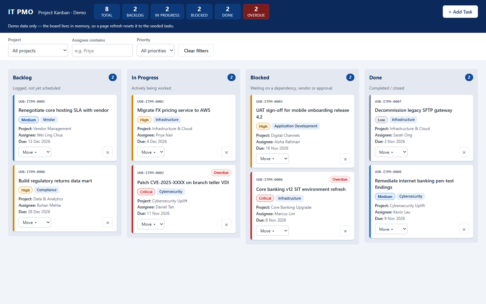

# kanban11 — IT PMO Project Kanban (Demo)

**Live demo (v2, cartoon revamp):** https://alfredang.github.io/kanban11/v2/
**Original v1:** https://alfredang.github.io/kanban11/

A single-file Kanban board demo for an IT PMO, built with vanilla HTML/CSS/JS. All markup, styles and script live in `index.html`.



## Placeholder content
Tasks are seed/demo data (IDs `UOB-ITPM-0001`–`0008`; due dates are computed relative to today). The notification email is the placeholder `YOUR_EMAIL@example.com`.

## Run locally
Open `index.html` in a browser (`Start-Process index.html` on Windows). No server or build needed.

## Configuration
Set your notification address in **one place only**: `FORMSUBMIT_ENDPOINT` in the config section at the top of the `<script>`. FormSubmit requires a one-time email activation per address (see the HTML comment above the script); until activated, new-task notifications are not delivered (the board still works, a warning toast is shown).

## Deployment
GitHub Actions (`.github/workflows/pages.yml`) deploys the repo root to GitHub Pages on every push to `main`. A `check` job runs `node --check` on the extracted script block first; `deploy` only runs if it passes.

## Conventions
- Vanilla only: no frameworks, CDNs, web fonts or image assets.
- No persistence (`localStorage`, cookies, etc.); a refresh resets to seed data.
- No `!important`; colours/spacing come from `:root` custom properties.
- Every user string goes through `escapeHtml()`; board DOM is built only in `renderBoard()`/`renderCard()`; events are delegated on `#board`.

## Testing
There is no test suite. Syntax check of the script block:
```bash
sed -n '/^<script>/,/^<\/script>/p' index.html | sed '1d;$d' > "$TEMP/k.js" && node --check "$TEMP/k.js"
```

## v2 (cartoon revamp, `v2/`)
- **Look:** thick-outline "sticker" cartoon style, bouncy card/tab/chart animations, confetti when a task reaches Done, animated mascot. All motion is wrapped in `prefers-reduced-motion: no-preference`.
- **Three tabs** (arrow-key navigable, deep-linkable via `#board`, `#visual`, `#timeline`): **Board** (drag-and-drop Kanban), **Visual** (KPIs, status donut, priority bars, per-project stacked bars, overdue rescue list), **Timeline** (Gantt-style start-to-due bars with a Today marker). The filters apply to all three.
- **Hardening:**
  - Strict CSP (`script-src 'self'`, `style-src 'self'`, `connect-src https://formsubmit.co`, `form-action 'none'`, `base-uri 'none'`, `object-src 'none'`), enabled by splitting the app into `index.html` / `styles.css` / `app.js` (no inline code).
  - No `innerHTML`: the DOM is built with `createElement`/`textContent`, so user text is never parsed as HTML.
  - Input sanitising (control and bidi characters stripped, length caps), whitelist validation of every enum and id, date validation, task cap, submit cooldown, ignoring foreign drag data, spreadsheet-formula neutralising in the notification email, `credentials: omit`, `redirect: error`, `no-referrer`, frame-busting, and `inert` background while the modal is open.
  - CI lints `v2/` for `innerHTML`, `eval`, `!important`, storage APIs and inline code.
  - Limits: GitHub Pages cannot send HTTP headers, so `frame-ancestors`/HSTS cannot be set (frame-busting JS is used instead).
